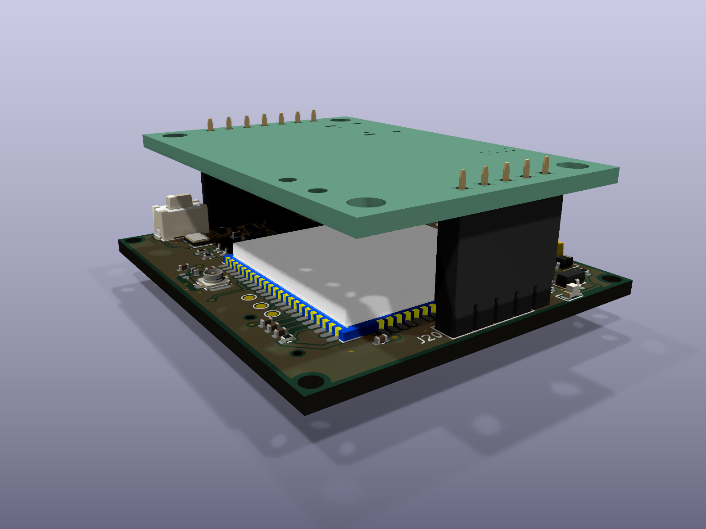
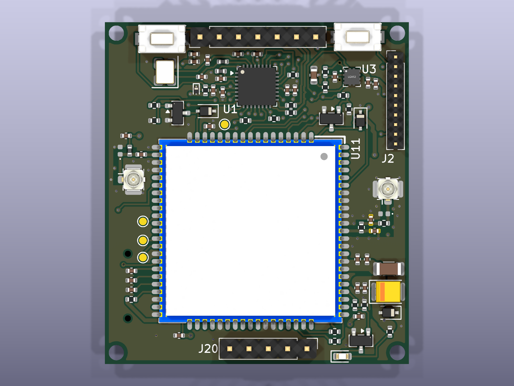
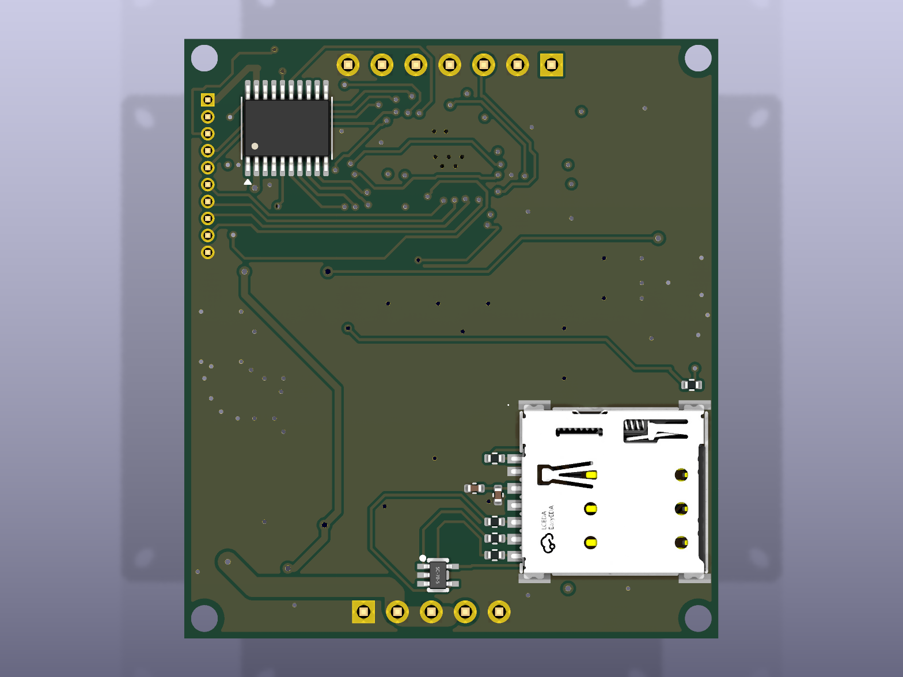
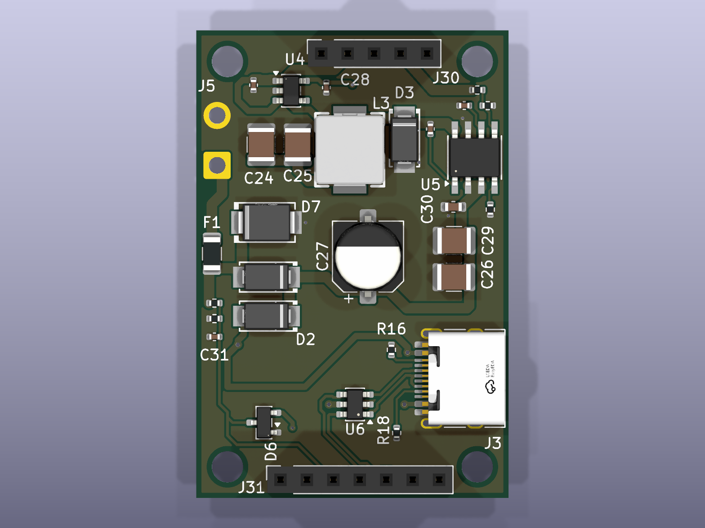

# 4G GPS Tracker for Motorcycles — V1 Prototype

A connected GPS tracker designed for motorcycles (moto-taxis and private owners), aimed at West and Central African markets (Côte d'Ivoire, DR Congo): real-time position tracking over 4G LTE with 2G fallback, motion detection, and direct power from the motorcycle's 12 V battery.

> Personal electronics design project: system architecture, component selection, schematics and PCB layout done in **KiCad 10**; fabrication and assembly by **JLCPCB**.
> Design files (schematics, PCB, manufacturing files) are not published; this repository showcases the project through images.

---

## Architecture

The tracker is made of **two stacked boards** connected through 2.54 mm headers (Power board mounted upside down on top of the RF board, as shown above):

| Board | Size | Layers | Role |
|---|---|---|---|
| **Power board** | 30 × 45 mm | 2 | Power supply and protection from the 12 V vehicle input or USB-C |
| **RF board** | 40 × 45 mm | 4 | 4G/2G modem + GNSS, microcontroller, sensors |

Splitting power and radio lets each block be tested and revised independently, and keeps the switching regulator away from sensitive RF circuitry.

---

## RF board — connectivity and processing

| Function | Component |
|---|---|
| LTE Cat-1 modem + 2G fallback + GNSS | SIMCom **A7672E-FASE** |
| Microcontroller (RISC-V, Wi-Fi 6, Bluetooth LE) | Espressif **ESP32-C6** (bare chip, 40 MHz crystal) |
| Motion / shock detection | ST **LIS2DW12** (low-power 3-axis accelerometer) |
| 1.8 V ↔ 3.3 V level translation | TI **TXS0108E** |
| SIM card | Nano-SIM holder with ESD protection |
| Antennas | Two separate U.FL connectors: LTE and GNSS |
| Programming / debug | Dedicated header, BOOT and RESET buttons |

**Design highlights:**
- **4-layer** PCB: solid ground plane (inner layer 1) and 3.3 V plane (inner layer 2) for RF signal integrity
- Antenna feed lines to the U.FL connectors, careful modem decoupling (high current bursts during 2G transmission)
- ESD protection on SIM, USB and exposed lines
- Double-sided assembly

---

## Power board — supply and protection

| Function | Component |
|---|---|
| Protected 12 V vehicle input | 2 A fuse + **SMBJ24A** TVS diode (vehicle load-dump / surges) |
| Dual power source | **SS56** Schottky diodes: 12 V vehicle **or** 5 V USB-C |
| Modem supply (~3.8 V, 3 A) | TI **LMR16030** buck converter (up to 60 V input) |
| 3.3 V logic rail | **ME6211** LDO regulator |
| USB-C | **USBLC6-2SC6** ESD protection, 5.1 kΩ CC resistors |
| Battery voltage monitoring | Resistor divider with **BAT54S** clamp to the ADC |

---

## Skills demonstrated

- Design of connected embedded systems (cellular LTE/2G, GNSS, BLE)
- Component selection under cost, availability and local frequency-band constraints
- Power supply design for automotive environments (12 V, surges, reverse polarity)
- 2- and 4-layer PCB layout, RF and EMC design rules
- Manufacturing preparation: Gerbers, bill of materials (BOM), placement file (CPL), SMT assembly

## Project status

- [x] Architecture and component selection
- [x] Schematics and layout of both boards (KiCad 10)
- [x] Manufacturing files and V1 prototype order (JLCPCB)
- [ ] V1 bring-up: power, 4G/2G network, GNSS reception
- [ ] ESP32-C6 firmware and tracking platform
- [ ] **V2**: single, more compact and cost-optimized board

---

*Junior Kabulo — mechatronics engineering student (embedded systems, PCB design, robotics).*
