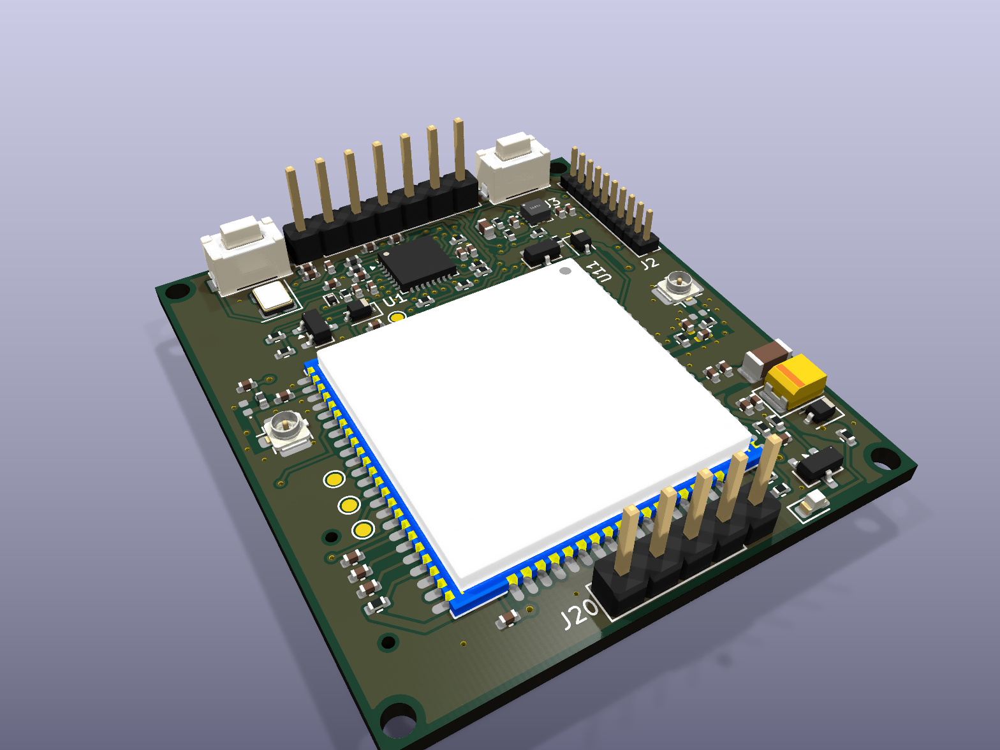
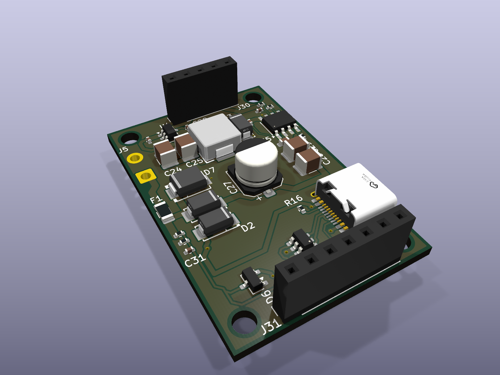

# Tracker GPS 4G pour motos — Prototype V1

Traceur GPS connecté conçu pour les motos (taxis-motos et particuliers), pensé pour les marchés d'Afrique de l'Ouest et centrale (Côte d'Ivoire, RDC) : suivi de position en temps réel via le réseau 4G LTE avec repli 2G, détection de mouvement et alimentation directe sur la batterie 12 V de la moto.

> Projet personnel de conception électronique : architecture, choix des composants, schémas et routage PCB réalisés sous **KiCad 10**, fabrication et assemblage chez **JLCPCB**.
> Les fichiers de conception (schémas, PCB, fichiers de fabrication) ne sont pas publiés ; ce dépôt présente le projet en images.

---

## Architecture

Le tracker est composé de **deux cartes empilées**, reliées par des connecteurs 2,54 mm :

| Carte | Taille | Couches | Rôle |
|---|---|---|---|
| **Carte Power** | 30 × 45 mm | 2 | Alimentation et protections depuis le 12 V moto ou l'USB-C |
| **Carte RF** | 40 × 45 mm | 4 | Modem 4G/2G + GNSS, microcontrôleur, capteurs |

Séparer la puissance de la partie radio permet de tester et faire évoluer chaque bloc indépendamment, et d'isoler le convertisseur à découpage des circuits RF sensibles.

---

## Carte RF — communication et intelligence

| Fonction | Composant |
|---|---|
| Modem LTE Cat-1 + repli 2G + GNSS | SIMCom **A7672E-FASE** |
| Microcontrôleur (RISC-V, Wi-Fi 6, Bluetooth LE) | Espressif **ESP32-C6** (puce nue, quartz 40 MHz) |
| Détection de mouvement / choc | ST **LIS2DW12** (accéléromètre 3 axes basse consommation) |
| Adaptation de niveaux 1,8 V ↔ 3,3 V | TI **TXS0108E** |
| Carte SIM | Support nano-SIM avec protection ESD |
| Antennes | 2 connecteurs U.FL séparés : LTE et GNSS |
| Programmation / débogage | Connecteur dédié, boutons BOOT et RESET |

**Points de conception :**
- PCB **4 couches** : plan de masse continu (couche interne 1) et plan 3,3 V (couche interne 2) pour l'intégrité des signaux RF
- Lignes d'antenne vers les connecteurs U.FL, découplage soigné du modem (pics de courant en émission 2G)
- Protections ESD sur la SIM, l'USB et les lignes exposées
- Montage double face

---

## Carte Power — alimentation et protections

| Fonction | Composant |
|---|---|
| Entrée 12 V moto protégée | Fusible 2 A + diode TVS **SMBJ24A** (surtensions du réseau de bord) |
| Double source d'alimentation | Diodes Schottky **SS56** : 12 V moto **ou** 5 V USB-C |
| Alimentation du modem (~3,8 V, 3 A) | Convertisseur abaisseur TI **LMR16030** (entrée jusqu'à 60 V) |
| Rail logique 3,3 V | Régulateur LDO **ME6211** |
| USB-C | Protection ESD **USBLC6-2SC6**, résistances CC 5,1 kΩ |
| Mesure de la tension batterie | Pont diviseur avec écrêtage **BAT54S** vers l'ADC |

---

## Compétences mises en œuvre

- Conception de systèmes embarqués communicants (cellulaire LTE/2G, GNSS, BLE)
- Choix de composants selon contraintes de coût, de disponibilité et de bandes de fréquences locales
- Conception d'alimentations pour environnement automobile (12 V, surtensions, inversion)
- Routage PCB 2 et 4 couches, règles de conception RF et CEM
- Préparation de la fabrication : Gerbers, nomenclature (BOM), fichier de placement (CPL), assemblage CMS

## État du projet

- [x] Architecture et choix des composants
- [x] Schémas et routage des deux cartes (KiCad 10)
- [x] Fichiers de fabrication et commande du prototype V1 (JLCPCB)
- [ ] Tests de la V1 : alimentation, réseau 4G/2G, réception GNSS
- [ ] Firmware ESP32-C6 et plateforme de suivi
- [ ] **V2** : carte unique plus compacte et optimisée en coût

---

*Junior Kabulo — étudiant ingénieur en mécatronique (systèmes embarqués, conception PCB, robotique).*
